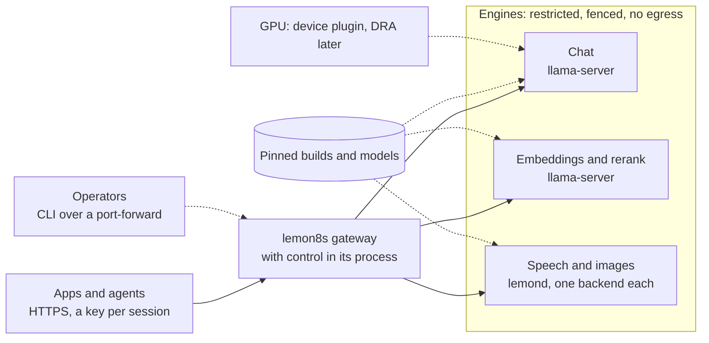

# The foundation: what runs where, and how it ships

This is lemon8s's plan for its foundation: what it runs, the pull requests that build it and in what order, how installs of 0.1 upgrade to 0.2, how releases are made, and how it's all tested.

> [!NOTE]
> Of the pull requests below, only P0 has landed. Everything after it is planned, and lemon8s is an experimental prototype, so plans may change as each pull request lands.

## The goal

lemon8s aims at one private AI endpoint where people, conversations, and roles stay apart. Running each engine in its own pod isolates code: a bug in one engine can't reach another engine's keys. It doesn't separate data, because an engine reads every prompt it serves. So people, conversations, and roles are kept apart by the gateway, by control, and by one engine per trust boundary.

| Promise | Enforced by | [Arrives in](#pull-requests-in-order) |
| --- | --- | --- |
| The key decides, not the request: a session key binds a person, tags, and a priority | the gateway and control | P5 |
| Only cleared people and trusted engines see a conversation | control's `User`, `Model`, and `ModelDeployment` resources, checked before a prompt leaves the gateway | P5 |
| One engine per trust boundary | one `ModelDeployment` per boundary, each in its own pod | P5 for one boundary, more with DRA |
| Answers keep their tags, and an answer cut short says why | the gateway | P5 |
| A KV cache per conversation, and no shared prompt cache | the gateway driving llama-server's slots, and `--cache-ram 0` | P5, with the shared cache off from P1 |
| Revoking access cuts live answers, and one session can be closed on its own | the gateway and control | P6 |
| An audit trail without content | control's event log | P5 |
| A fenced engine: no egress, no credentials beyond its own keys, no service account token, a read-only model and build, and reachable only from the gateway | NetworkPolicy, restricted Pod Security, a Secret per engine, and image volumes | P5 for llama-server engines, P7 for `lemond` engines |
| Failures never widen access | the gateway and control fail closed | P5 |
| Only pinned artifacts serve | images by digest, models by SHA-256 | P3 and P5 |

## The target picture

| Component | Runs as | Trust | Holds | Reached by |
| --- | --- | --- | --- | --- |
| Gateway, with control in its process | a Deployment with one replica, updated with `Recreate`; Service `<release>` on `gateway.service.port` | trusted | the TLS key, session-key hashes, the queue, slot tables, each engine's API key, and control's log on its own volume | apps, through the Service; operators' `login` and `status`, only on its loopback |
| Chat, embeddings, and rerank engines | a Deployment each, running llama-server directly, with its build and model as read-only volumes | untrusted | its API key and its model | the gateway only |
| Speech-to-text, text-to-speech, and image engines | a Deployment each, running `lemond` with one backend, offline | untrusted | its API key, its own admin key, and its own volume | the gateway only |
| Model fetch | a Job per model, named by the model's digest, running lemon8s's own image | untrusted, with egress only to DNS and port 443 | the model while fetching it | nobody |
| Engine builds | OCI images on ghcr.io, built by this repository from Lemonade's release archives | read-only data | binaries | the pods that mount them |
| GPU | AMD's GPU device plugin, and DRA later | node | device files | the kubelet |



Fences select pods by the label `lemon8s.io/zone`, `gateway` or `engine`, never by a selector label, so selectors never change and every new engine is fenced. Engines are a map keyed by name, such as `engines.chat` and later `engines.finance-chat`, never by kind, so a second trust boundary can sit beside the first. Engine names are capped at 63 characters.

## Decisions

| Decision | Outcome | Why |
| --- | --- | --- |
| Kubernetes | 1.35 to 1.37; the chart refuses older clusters | image volumes, which carry engines' builds and models, are on by default from 1.35, so they need no fallback |
| Front door | lemon8s's own gateway, written in Rust, with no proxy in the meantime | a standard proxy could add a key per person, but not a KV cache per conversation, revocation that cuts live answers, or waiting for a slot on a trusted engine, so it would be replaced |
| Engines | one per name, each for one trust boundary: llama-server directly for chat, embeddings, and rerank, and `lemond` with one backend for speech and images | the gateway drives llama-server's slots itself, and `lemond` keeps Lemonade's adapters where llama-server has no OpenAI route |
| Keys | a Secret per engine, with an API key that only the engine and the gateway hold and, for `lemond`, an admin key that only its pod holds; the shared key retires in P5 | a compromised engine exposes only its own keys, and the gateway never holds an admin key |
| Volumes | a volume per `lemond` engine; each model fetched by a Job named by the model's digest | no engine can change another's files, and a new model gets a new Job, since a Job can't be edited |
| Namespaces | one, with zones by label; a namespace per zone once control creates engines | that's when access rules per zone start to matter |
| Reaching the gateway | `gateway.service.type`, `LoadBalancer` by default; a port-forward is for operators | the gateway terminates TLS and checks every request, so it's built to face the network, and a port-forward reaches its loopback, where operator commands answer |
| Engines' egress | removed as each engine stops needing it: llama-server engines in P5, `lemond` engines in P7 | today's `lemond` downloads its builds and models, so removing egress sooner would break it |
| 0.2's scope | chat only; embeddings, rerank, speech, and images pause until P7 | separation reaches users soonest, and those endpoints were never documented or tested on `main` |
| GPU | the chat engine holds the GPU, and other engines run on the CPU until DRA can share it; GPU memory is requested as pod memory | AMD's device plugin gives each GPU to one pod, and an integrated GPU's memory is system memory that Kubernetes doesn't count against the pod |
| Shared prompt cache | off from P1, with `--cache-ram 0`, and its cost measured | llama-server's shared cache [has restored one conversation's content into another's](https://github.com/ggml-org/llama.cpp/issues/27148); until P5, it's a default, not enforced |
| Values | regrouped under `engines.<name>` in P5's breaking release; a strict schema with bounds; `settings` free-form except keys the chart owns; nothing needs a null to turn it off | a strict schema names a misspelled or removed key, and `--reset-then-reuse-values` drops a null that overrides a stored value |
| CRDs | in `crds/`, applied with `kubectl apply --server-side --force-conflicts --field-manager=helm` before every upgrade, keeping Helm as their fields' owner, so a later install with changed CRDs still works | Helm installs `crds/` on the first install only |
| GitOps | Argo CD users supply `engines.<name>.existingSecret`; CI renders the chart twice and fails on any difference | generated keys come from Helm's `lookup`, which doesn't run under `helm template`, so they would change on every sync |
| Helm | Helm 4, and a Helm 3 render job until February 2027 | Helm 3's security fixes end then |

## Pull requests, in order

| PR | Adds | Changes for users | Tested by |
| --- | --- | --- | --- |
| P0 Stability, merged as [#8](https://github.com/lemonade-sdk/lemon8s/pull/8) | upgrade from `main`, rollback, reinstall keeping the volume, NOTES.txt, and kind on 1.35 | nothing | itself |
| P1 Hardening | `kubeVersion` and recommended labels; a device turned off with a count of 0, and `--set-json 'deviceGroups=[]'` for no groups; schema bounds; the shared prompt cache off; the NetworkPolicy check restores the policy after showing traffic flows without it; the render-twice check; the Helm 3 render job; a lint that fails on `pull_request_target` and `workflow_run` triggers; a weekly Trivy scan of every image the chart and CI pin, which opens an issue on findings; NOTES.txt calls a port-forward operator access | clusters older than 1.35 are refused; after install, a device is turned off with a count of 0, not `devices=null` | helm-unittest, the render checks, and P0's upgrade job |
| P2 Releasing | the release workflows and the `release` environment, with each release job limited to this repository so forks never run them; `.github/RELEASING.md`, with a table per workflow and a diagram from pull request to release; release-notes configuration; the README installs the released chart by exact version; then `0.1.0-alpha` | a pinned, attested alpha to install and upgrade from | a dry run of each workflow on pull requests that change it |
| P3 Images and Rust | llama.cpp builds for the CPU, Vulkan, and ROCm from Lemonade's release archives, each SHA-256 pinned; Rust CI (`fmt`, `clippy`, tests, `cargo deny`, and `cargo about`) and Dependabot for Cargo; each image built once per pull request and side-loaded into all seven test platforms; a scan before any push; a CPU llama-server in a restricted pod with an image volume on every platform | nothing | the new jobs, on every pull request |
| P4 Control and CRDs | the `policy` and `control` crates; the `User`, `Model`, and `ModelDeployment` CRDs; the CLI's operator commands | nothing uses them yet | unit tests, control against a kind API server, and the CRD step in the upgrade job |
| P5 The gateway for chat, breaking, as `0.2.0-alpha` | the `engine` and `gateway` crates and image; TLS; session keys; allowlists of routes and fields; slots; control's log; chat on llama-server with P3's build and a model from a fetch Job; a Secret per engine; fences; no egress for llama-server engines; values under `engines.<name>`; GPU memory requested as pod memory; a PriorityClass for the gateway; CLI binaries on releases; Cilium's `policyCIDRMatchMode: nodes` in CI and the README; the README's K3s install keeps ServiceLB, so the default `LoadBalancer` Service gets an address; the API server's address for the gateway's egress, read with `lookup`, and an error when it's empty unless set by hand | the [upgrade](#upgrading-from-01-to-02) below | the end-to-end tests through the gateway with a session key and fences kept, on all seven platforms; the separation tests; the upgrade job from `0.1.0-alpha`, with the documented commands |
| P6 Revocation and status | revocation that cuts live answers, closing one session, `status`, and the log's size as a metric | revoking access works | a revoked stream ends with `access_revoked` |
| P7 Engines behind the gateway | embeddings and rerank on llama-server; speech and images on `lemond`, offline, each with its own volume and P3's builds | the paused endpoints return | [#5](https://github.com/lemonade-sdk/lemon8s/pull/5)'s endpoint tests, through the gateway |
| Later | models beyond the test model, model packing, and an offline bundle; GPU sharing and a second trust boundary with DRA; the NPU | | |

In P7, #5's endpoint tests stay at the OpenAI API, with models from `ModelDeployment`s instead of `/v1/pull` and `/v1/load`.

## Upgrading from 0.1 to 0.2

| What | 0.1 | 0.2 | What you do |
| --- | --- | --- | --- |
| URL | `http://localhost:13308/v1`, through a port-forward | `https://<address>:13308/v1`, through the gateway's Service, with a certificate made for each install | trust its CA, with `kubectl -n <ns> get secret <release>-gateway-tls -o jsonpath='{.data.ca\.crt}' \| base64 -d > lemon8s-ca.pem`, then `SSL_CERT_FILE=lemon8s-ca.pem` for the OpenAI SDKs |
| Keys | one shared key, in `<release>-api-key` | a key per person and session; the shared key stops working | an operator runs `lemon8s session create --user <name>` and hands out the key |
| Admin access | `kubectl exec deploy/<release> -- lemonade ...` | gone: clients can't pull or load models | operators declare `Model` and `ModelDeployment` resources |
| Models | downloaded by Lemonade into `<release>-models` | fetched by a Job and checked against a pinned SHA-256; the default model keeps its name, `Qwen3-0.6B-GGUF` | models download again; keep `<release>-models` for a rollback, then delete it with `kubectl delete pvc` |
| Endpoints | chat; embeddings, rerank, audio, and images also answer, undocumented | chat only, until P7 | stay on 0.1 until P7 if you need the others |
| Values | `backend`, `settings`, `devices`, `deviceGroups`, `resources`, and `storage` at the top level | under `engines.chat`; `apiKey.existingSecret` is removed | move each value as the release notes' table shows |
| CRDs | none | three | apply them before the upgrade, as below |
| Downtime | | the old pod stops; chat answers once the gateway is up and its model has loaded | plan a short outage |

```bash
helm -n <ns> get values <release> -o yaml > values-0.1.yaml   # move each value into values-0.2.yaml, as the release notes show
helm pull oci://ghcr.io/lemonade-sdk/charts/lemon8s --version 0.2.0-alpha --untar
kubectl apply --server-side --force-conflicts --field-manager=helm -f lemon8s/crds/
helm -n <ns> upgrade <release> ./lemon8s --reset-values -f values-0.2.yaml
kubectl -n <ns> rollout status deploy/<release>-gateway --timeout=15m
```

A breaking release always upgrades this way, because `--reset-then-reuse-values` would carry 0.1's stored values into 0.2's strict schema, which rejects them. Other releases keep the [playbook's](../playbooks/lemonade-on-kubernetes.md#change-a-setting) `--reset-then-reuse-values`. CI's upgrade job runs these exact commands.

## Releases and the supply chain

**Versions.** Every release is `0.MINOR.PATCH-alpha`: a breaking change bumps the minor version, and a fix the patch. `main`'s `Chart.yaml` carries the last release's version, and preparing a release sets the next.

**Every release is marked alpha:** by its prerelease version, which Helm skips unless given `--devel` or the exact `--version`; by GitHub's pre-release flag; by a banner at the top of its notes; by a `lemon8s.io/maturity: alpha` annotation on the chart; by image descriptions that start with "Alpha:"; and by NOTES.txt's first line. No image is ever tagged `latest`.

**Where releases go.** Only to GitHub, beside the source: the chart as a `.tgz` on the GitHub Release and at `oci://ghcr.io/lemonade-sdk/charts/lemon8s`, images on ghcr.io, and, from 0.2, the CLI for Linux (amd64), Windows (amd64), and macOS (arm64) on the Release.

**Releasing, from the browser**, so a release needs no local tools or long-lived keys:

| Step | Where | What runs |
| --- | --- | --- |
| 1. Prepare | Actions → **Prepare release**, with the version | builds the images, CLI, and chart; once a maintainer approves, pushes and attests the images; pins their digests on a `release/<version>` branch and drafts a pre-release |
| 2. Pull request | **Compare & pull request**, then merge | every required job runs on exactly the images and chart that ship |
| 3. Publish | Releases → the draft → add upgrade steps and downtime to the notes → **Publish** | publishing creates the tag at the tested commit; a job in the `release` environment pushes the same chart to ghcr.io and attests it |

If a release is abandoned after step 1, its images keep their tag, and the next attempt bumps the patch. Release immutability is on, and tag rulesets make tags permanent and admin-only. Release notes are GitHub's generated notes, grouped by label, so there's no changelog file to keep or to conflict on.

**Pull requests.** Images build only when their inputs change, with no permissions, and Rust builds outside Docker with `target/` cached by `actions/cache`. Pull requests' caches never feed a release. Pull requests that don't change an image use the pinned digests, so CI tests what ships. Nothing is pushed outside step 1.

**Hashes.** Lemonade's release archives carry no published hash, so the SHA-256s that P3 pins are trusted on first use, until Lemonade publishes them.

| Tool | Use | Why |
| --- | --- | --- |
| `actions/attest` | provenance and SBOM attestations for images, the chart, and the CLI, pinned by commit | keyless, and users check anything with `gh attestation verify`; for a public repository, GitHub records attestations, which hold only digests and the workflow's identity, in Sigstore's public log |
| cargo-deny | license and advisory policy, in CI only, pinned by checksum | a dependency with an unapproved license or a known advisory fails the pull request |
| cargo-about | third-party notices, inside each image | the notices travel with the binaries they cover |
| Trivy | scans before any push and every week, and SBOMs from `Cargo.lock`; run from its image by digest | its GitHub Actions, `trivy-action` and `setup-trivy`, were [compromised in March 2026](https://github.com/aquasecurity/trivy/security/advisories/GHSA-69fq-xp46-6x23) |
| BuildKit's SBOM scanner | the base image's SBOM, by digest | Trivy's SBOM from `Cargo.lock` covers only the Rust crates |
| skopeo | pushing the built image archives | it comes with the runner, so there's nothing new to download |

cargo-auditable, which records crates in the binary, isn't used, so that no extra tool sits in the compiler's path.

## Tests

Every pull request runs [the checks in CONTRIBUTING](../../.github/CONTRIBUTING.md#tests). The plan adds:

| Layer | What runs |
| --- | --- |
| Rust | `fmt`, `clippy`, tests, and `cargo deny` |
| Images | a build when inputs change, a scan, and a side-load into seven platforms |
| Fences | kept during the tests; reach shown from a pod labeled as the gateway; no egress shown with `kubectl debug --profile=restricted` |
| Separation | a session can't use another's key; two conversations never share a slot; a revoked stream ends with `access_revoked`; an engine refuses a request without its key; no pod holds another's keys, compared by hash and never printed |
| Upgrade | from the last release to the pull request, with that release's documented commands; rollback; reinstall keeping volumes; and, when control's log format changes, across the change |

## Still open

1. Do image volumes work in Rancher Desktop's containerd? P3 shows it or finds the gap.
2. Can a `lemond` engine be held to its one backend, offline? P7 shows it or not.
3. Where P4 ends and P5 begins inside the crates.

## Glossary

| Term | Meaning |
| --- | --- |
| Attestation | a signed record of which workflow built an artifact |
| Control | the gateway's policy library, for people, models, sessions, and the event log; it sees metadata, never prompts |
| DRA | Dynamic Resource Allocation, Kubernetes' API for devices, through which pods may share a GPU once its driver supports it |
| Engine | a pod that runs a model: llama-server, or `lemond` with one backend |
| Engine key | the key the gateway sends an engine; never a person's |
| Fence | the NetworkPolicy and Pod Security rules around an engine |
| Gateway | lemon8s's front door: it terminates TLS, checks each request's session key, and sends the request to an engine trusted with its tags |
| KV cache | a model's saved state for the tokens it has already read, so a conversation's next turn doesn't recompute them |
| `lemon8s` CLI | the command-line tool for operators, with `login`, `session create`, and `status` |
| `lemond` | Lemonade's server, which runs a backend for each model it loads |
| llama-server | [llama.cpp](https://github.com/ggml-org/llama.cpp)'s OpenAI-compatible server |
| Session key | the key a client sends; control binds it to a person and tags |
| Side-load | putting an image built in CI into a test cluster without a registry |
| Slot | one of llama-server's contexts, holding one conversation's KV cache |
| Tag | a kind of data a conversation may hold, such as `finance`; people are cleared for tags, and engines trusted with them |
| Trust boundary | the set of tags an engine may receive; one engine per boundary |
| `User`, `Model`, and `ModelDeployment` | control's custom resources: a person and the tags they're cleared for, a pinned model, and an engine serving a model for one trust boundary |
| Zone | the value of the `lemon8s.io/zone` label, which fences select on |
