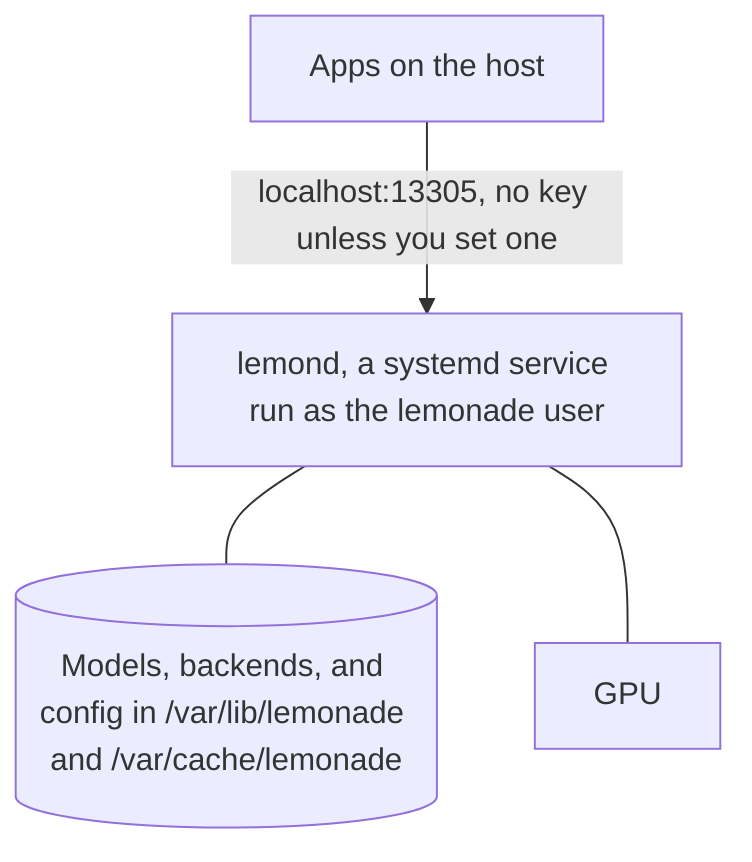
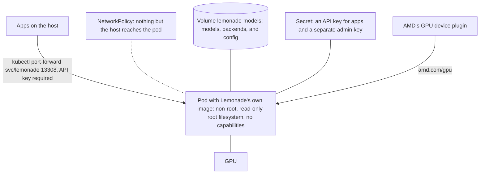

# Run Lemonade on Kubernetes

This playbook runs Lemonade's server on Kubernetes, on one host. Install it with the README's [Try it](../../README.md#try-it) steps. This playbook covers what comes after: how it differs from Lemonade on its own, day-to-day changes, the NPU, what to do when something goes wrong, and common questions.

## How it compares with Lemonade on its own

Both run the same Lemonade server. lemon8s runs it in a locked-down pod, keeps its files on a Kubernetes volume, and requires an API key.

Lemonade on its own, installed from its Linux package:



lemon8s today, on K3s:



## Change a setting

[values.yaml](../../deploy/chart/lemon8s/values.yaml) lists the settings. Change one with an upgrade, which keeps your other settings and takes the chart's new defaults, then start the port-forward again, because it follows one pod and the pod restarts:

```bash
helm -n lemonade upgrade lemonade deploy/chart/lemon8s --reset-then-reuse-values --set backend=rocm
```

Other settings work the same way:

- **Run on the CPU only:** `--set "devices.amd\.com/gpu=0" --set backend=cpu`. To give the pod the GPU again: `--set "devices.amd\.com/gpu=1" --set backend=auto`.
- **Another device instead of the GPU:** a device you add joins the default `amd.com/gpu` entry rather than replacing it, so set that entry to 0: `--set "devices.amd\.com/gpu=0" --set "devices.<resource>=1"`. A count of 0 leaves a device out, and later upgrades keep it.
- **Another Service port:** `--set service.port=13310`, then forward that port instead of 13308. To change only the port on the host, forward another local port instead, as Troubleshooting shows.
- **Any of Lemonade's settings,** by its name in Lemonade's `config.json`, such as `--set settings.ctx_size=8192`; for the llama.cpp backend, use `backend`. A setting changed through Lemonade itself takes precedence over the chart's.
- **CPU and memory for the pod,** on a host it shares: `--set resources.requests.cpu=2 --set resources.requests.memory=8Gi`.
- **Which node it runs on,** in a cluster with more than one: `nodeSelector`, `tolerations`, and `affinity`. On K3s's default storage, set them at install, because the volume stays on the node where the pod first ran.
- **Keys from a Secret of your own,** with two different, non-empty keys, `api-key` and `admin-api-key`: `--set apiKey.existingSecret=<name>`.

The volume's size and storage class are set at install, and an upgrade can't change them.

## Use the NPU

Lemonade runs models on an AMD XDNA 2 NPU, such as a Strix Halo's, through FastFlowLM, its NPU engine, which step 4 installs in the pod. This has been tested on a Strix Halo with K3s, with the NPU as the pod's only device:

1. Install the NPU's driver and firmware as Lemonade's [Linux NPU guide](https://lemonade-server.ai/flm_npu_linux.html) describes, until `cat /sys/bus/pci/drivers/amdxdna/*/fw_version` shows NPU firmware 1.1.0.0 or later. Skip the guide's FastFlowLM and locked-memory steps: the pod has its own FastFlowLM, and the next step raises the limit for pods.

2. Raise the locked-memory limit that K3s passes to every pod. K3s's default is 8 MB, and FastFlowLM refused to run with 64 MB but ran with 128 MB. 1G was enough for a 4B model, because the memory FastFlowLM maps for the NPU counts against the pod's memory, not this limit. On a host that joined as an agent, use `k3s-agent` in place of `k3s`:

   ```bash
   sudo mkdir -p /etc/systemd/system/k3s.service.d
   printf '[Service]\nLimitMEMLOCK=1G\n' | sudo tee /etc/systemd/system/k3s.service.d/memlock.conf
   sudo systemctl daemon-reload && sudo systemctl restart k3s
   ```

3. Install a device plugin that offers the NPU, and nothing else, as `devic.es/npu` (the plugin's default name, after its author's domain), and wait until the node offers it. Then give the NPU to lemon8s in place of the GPU, with llama.cpp's models on the CPU. The upgrade restarts the pod, which picks up the new limit:

   ```bash
   kubectl apply -f deploy/npu-device-plugin.yaml
   kubectl wait node --all --for=jsonpath='{.status.allocatable.devic\.es/npu}'=1 --timeout=2m
   helm -n lemonade upgrade lemonade deploy/chart/lemon8s --reset-then-reuse-values \
     --set "devices.amd\.com/gpu=0" --set "devices.devic\.es/npu=1" --set backend=cpu
   kubectl -n lemonade rollout status deploy/lemonade --timeout=15m
   ```

4. Install FastFlowLM in the pod, and load one of its models:

   ```bash
   kubectl -n lemonade exec deploy/lemonade -- lemonade backends install flm:npu
   kubectl -n lemonade exec deploy/lemonade -- lemonade load qwen3-0.6b-FLM
   ```

A pod memory limit also bounds the memory FastFlowLM maps for the NPU. Under a 3 GiB limit, Qwen3-0.6B, which maps 1.5 GB, ran, but Gemma 3 4B, which maps 4.2 GB, failed at its first request with "Failed to load gemma3:4b model!", though Lemonade had reported it loaded. Set the pod's memory requests and limits above what the model maps, or leave them unset.

To leave the NPU, set its count to 0 in an upgrade: `--set "devices.devic\.es/npu=0" --set backend=cpu` runs on the CPU only, and `--set "devices.devic\.es/npu=0" --set "devices.amd\.com/gpu=1" --set backend=auto` gives the pod the GPU again.

## Reach it from another computer

Forward the port over SSH, then use the same URL, key, and model name there:

```bash
ssh -N -L 13308:localhost:13308 <you>@<host>
```

## Issue new keys

Apps use the `api-key` in the `lemonade-api-key` Secret. The `admin-api-key` beside it can also change Lemonade's settings, so keep it to yourself; `kubectl -n lemonade exec deploy/lemonade -- lemonade ...` uses it from inside the pod. To replace both keys:

```bash
kubectl -n lemonade delete secret lemonade-api-key
helm -n lemonade upgrade lemonade deploy/chart/lemon8s --reset-then-reuse-values
kubectl -n lemonade rollout restart deploy/lemonade
```

The old keys stop working once the pod restarts. With a Secret of your own, replace its keys, then run only the last command.

## Uninstall

`helm -n lemonade uninstall lemonade` removes lemon8s and its keys but keeps the models' volume, so a reinstall doesn't download them again. `kubectl -n lemonade delete pvc lemonade-models` removes the volume. K3s has its own [uninstall script](https://docs.k3s.io/installation/uninstall), which leaves the NPU's locked-memory limit behind; to undo the NPU's setup, run `kubectl delete -f deploy/npu-device-plugin.yaml`, then `sudo rm /etc/systemd/system/k3s.service.d/memlock.conf && sudo systemctl daemon-reload && sudo systemctl restart k3s`.

## Troubleshooting

**The pod stays Pending.** `kubectl -n lemonade describe pod` shows why. `Insufficient amd.com/gpu` means no device plugin offers the GPU: check that it runs, with `kubectl -n kube-system get pods`, and that the node offers it, with `kubectl get node -o jsonpath='{.items[0].status.allocatable}'`.

**`helm install` stops with "Set deviceGroups".** The pod needs the host groups that may open the GPU's device files. Pass `--set "deviceGroups={$(getent group render | cut -d: -f3)}"`.

**`lemonade load` fails with "Couldn't resolve host name".** The pod can't resolve names, even if the host can. Check with `kubectl -n lemonade exec deploy/lemonade -- getent hosts huggingface.co`. On networks where some of the host's DNS servers don't answer, point K3s at one that does (`resolvectl status` shows which one the host uses):

```bash
echo "nameserver <a DNS server that answers>" | sudo tee /etc/rancher/k3s/resolv.conf
echo "resolv-conf: /etc/rancher/k3s/resolv.conf" | sudo tee -a /etc/rancher/k3s/config.yaml
sudo systemctl restart k3s
kubectl -n kube-system rollout restart deploy/coredns
```

**The port-forward fails.** Another program on the host holds port 13308. Forward another local port, such as `kubectl -n lemonade port-forward svc/lemonade 13309:13308`, and use it in the URL.

**Apps get "connection refused" after an upgrade or restart.** The port-forward ended with the old pod. Start it again.

**A small model takes most of the GPU's memory.** Lemonade sizes the context automatically. On a Strix Halo, Qwen3-4B-Instruct-2507 got a 262,144-token context and took about 39 GiB; with `--ctx-size 8192` it took under 4 GiB:

```bash
kubectl -n lemonade exec deploy/lemonade -- lemonade load Qwen3-4B-Instruct-2507-GGUF --ctx-size 8192
```

To make that the default for every model, set `settings.ctx_size=8192` in an upgrade.

**A model runs on the CPU, though the host has a GPU.** With `backend=auto`, Lemonade picks the best llama.cpp build already on the volume, and downloads one only when there's none. So once only the CPU build is there, `auto` keeps using it. Set the backend you want, and give the pod the GPU again if you ran it on the CPU only: `--set backend=vulkan --set "devices.amd\.com/gpu=1"`, in an upgrade.

**Loading an NPU model fails with "FLM NPU validation failed".** The rest of the message says why. "NPU firmware is incompatible" means the host needs newer NPU firmware, and "Memlock limits are too low" means K3s's locked-memory limit hasn't been raised, or the pod started before it was: raise it, then restart the pod with `kubectl -n lemonade rollout restart deploy/lemonade`. Both are steps in [Use the NPU](#use-the-npu).

**The host's disk fills up.** On K3s, the volume lives on the host's disk, under `/var/lib/rancher/k3s/storage` by default, and its size isn't enforced. Delete models you don't need with `kubectl -n lemonade exec deploy/lemonade -- lemonade delete <model>`, or install K3s with `--default-local-storage-path` pointing at a larger disk.

## Questions

**How useful is it today?** It gives apps on one host, and on other computers through SSH, one Lemonade server with an API key, managed by Kubernetes. For one person, Lemonade on its own does the same with fewer steps. lemon8s becomes more useful after more features land: data tags, more hosts behind one URL, and access for each person.

**How safe is it?** It keeps three promises: only its host can reach it, every request but Lemonade's liveness check needs the API key, and that key can't change Lemonade's settings. The pod runs without root, privileges, or a writable root filesystem. There's no TLS yet, and everyone shares one key.

**Does it run on Windows?** Not yet. Kubernetes needs Linux for its control plane, and K3s has no Windows build. On Windows 10 or 11, [Rancher Desktop](https://rancherdesktop.io) runs K3s in WSL2, and running lemon8s there, on the CPU first, is planned.

**Does it work with other GPUs, or with NPUs?** Today the chart requests any device a device plugin offers, through `devices`. AMD's GPU device plugin and a Strix Halo's NPU, as [Use the NPU](#use-the-npu) describes, have each served models; other GPUs, and the GPU and NPU together in one pod, haven't been tested.

**Why Kubernetes instead of Lemonade on its own?** For one person on one host, Lemonade on its own is simpler. Kubernetes is the base for what's planned: several hosts behind one URL, access for each person, and standard tools, such as Helm, role-based access control, and NetworkPolicy, to run it.
