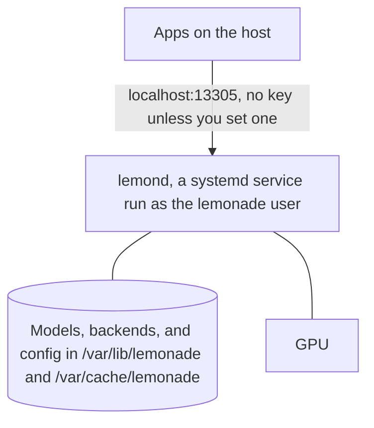

# Run Lemonade on Kubernetes

This playbook runs Lemonade's server on Kubernetes, on one host. Install it with the README's [Try it](../../README.md#try-it) steps. This playbook covers what comes after: how it differs from Lemonade on its own, day-to-day changes, what to do when something goes wrong, and common questions.

## How it compares with Lemonade on its own

Both run the same Lemonade server. lemon8s runs it in a locked-down pod, keeps its files on a Kubernetes volume, and requires an API key.

Lemonade on its own, installed from its Linux package:



lemon8s today, on K3s:


## Change a setting

[values.yaml](../../deploy/chart/lemon8s/values.yaml) lists the settings. Change one with an upgrade, then start the port-forward again, because it follows one pod and the pod restarts:

```bash
helm -n lemonade upgrade lemonade deploy/chart/lemon8s --reuse-values --set backend=rocm
```

To run on the CPU only, use `--set devices=null --set backend=cpu`. A backend set through Lemonade's own settings takes precedence over the chart's. The volume's size and storage class are set at install, and an upgrade can't change them.

## Reach it from another computer

Forward the port over SSH, then use the same URL, key, and model name there:

```bash
ssh -N -L 13305:localhost:13305 <you>@<host>
```

## Issue new keys

Apps use the `api-key` in the `lemonade-api-key` Secret. The `admin-api-key` beside it can also change Lemonade's settings, so keep it to yourself; `kubectl -n lemonade exec deploy/lemonade -- lemonade ...` uses it from inside the pod. To replace both keys:

```bash
kubectl -n lemonade delete secret lemonade-api-key
helm -n lemonade upgrade lemonade deploy/chart/lemon8s --reuse-values
kubectl -n lemonade rollout restart deploy/lemonade
```

The old keys stop working once the pod restarts.

## Uninstall

`helm -n lemonade uninstall lemonade` removes lemon8s and its keys but keeps the models' volume, so a reinstall doesn't download them again. `kubectl -n lemonade delete pvc lemonade-models` removes the volume. K3s has its own [uninstall script](https://docs.k3s.io/installation/uninstall).

## Troubleshooting

**The pod stays Pending.** `kubectl -n lemonade describe pod` shows why. `Insufficient amd.com/gpu` means no device plugin offers the GPU: check that it runs, with `kubectl -n kube-system get pods`, and that the node offers it, with `kubectl get node -o jsonpath='{.items[0].status.allocatable}'`.

**`helm install` stops with "Set deviceGroups".** The pod needs the host groups that may open the GPU's device files. Pass `--set "deviceGroups={$(getent group render | cut -d: -f3)}"`.

**`lemonade load` fails with "Couldn't resolve host name".** The pod can't resolve names, even if the host can. Check with `kubectl -n lemonade exec deploy/lemonade -- getent hosts huggingface.co`. On networks where some of the host's DNS servers don't answer, point K3s at one that does (`resolvectl status` shows which one the host uses):

```bash
echo "nameserver <a DNS server that answers>" | sudo tee /etc/rancher/k3s/resolv.conf
echo "resolv-conf: /etc/rancher/k3s/resolv.conf" | sudo tee -a /etc/rancher/k3s/config.yaml
sudo systemctl restart k3s
kubectl -n kube-system rollout restart deploy/coredns
```

**The port-forward fails, or apps work without a key.** Another Lemonade on the host holds port 13305. Stop it with `sudo systemctl stop lemond`, or forward another port, such as `kubectl -n lemonade port-forward svc/lemonade 13306:13305`.

**Apps get "connection refused" after an upgrade or restart.** The port-forward ended with the old pod. Start it again.

**A small model takes most of the GPU's memory.** Lemonade sizes the context automatically. On a Strix Halo, Qwen3-4B-Instruct-2507 got a 262,144-token context and took about 39 GiB; with `--ctx-size 8192` it took under 4 GiB:

```bash
kubectl -n lemonade exec deploy/lemonade -- lemonade load Qwen3-4B-Instruct-2507-GGUF --ctx-size 8192
```

**The host's disk fills up.** On K3s, the volume lives on the host's disk, under `/var/lib/rancher/k3s/storage` by default, and its size isn't enforced. Delete models you don't need with `kubectl -n lemonade exec deploy/lemonade -- lemonade delete <model>`, or install K3s with `--default-local-storage-path` pointing at a larger disk.

## Questions

**How useful is it today?** It gives apps on one host, and on other computers through SSH, one Lemonade server with an API key, managed by Kubernetes. For one person, Lemonade on its own does the same with fewer steps. lemon8s becomes more useful after more features land: data tags, more hosts behind one URL, and access for each person.

**How safe is it?** It keeps three promises: only its host can reach it, every request but Lemonade's liveness check needs the API key, and that key can't change Lemonade's settings. The pod runs without root, privileges, or a writable root filesystem. There's no TLS yet, and everyone shares one key.

**Does it run on Windows?** Not yet. Kubernetes needs Linux for its control plane, and K3s has no Windows build. On Windows 10 or 11, [Rancher Desktop](https://rancherdesktop.io) runs K3s in WSL2, and running lemon8s there, on the CPU first, is planned.

**Does it work with other GPUs, or with NPUs?** The chart requests any device a device plugin offers, through `devices`, but only AMD's GPU device plugin on a Strix Halo has been tested. NPUs are planned.

**Why Kubernetes instead of Lemonade on its own?** For one person on one host, Lemonade on its own is simpler. Kubernetes is the base for what's planned: several hosts behind one URL, access for each person, and standard tools, such as Helm, role-based access control, and NetworkPolicy, to run it.
